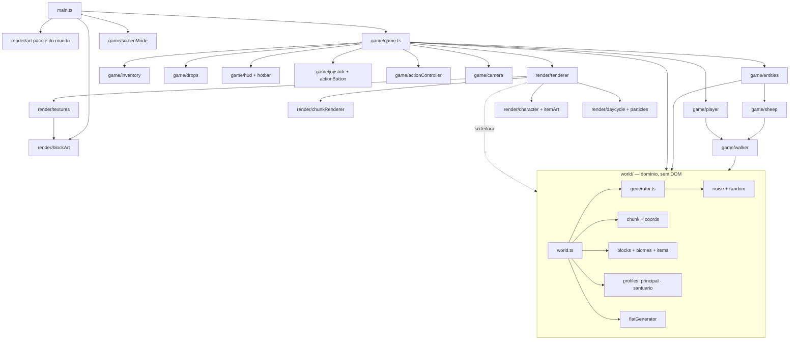
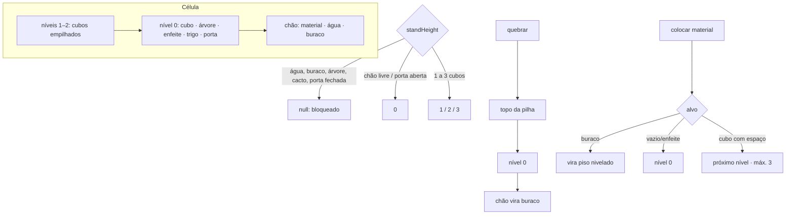
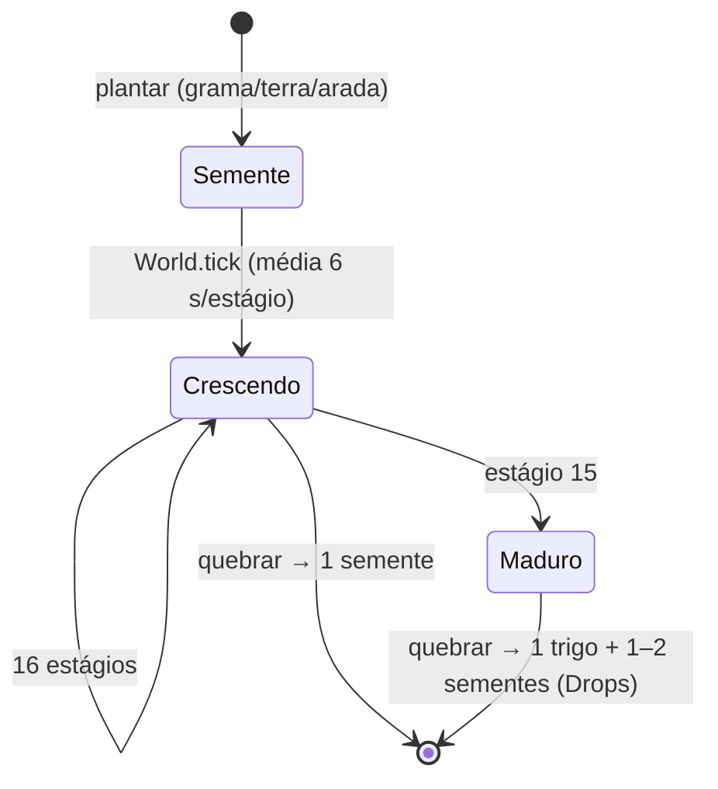
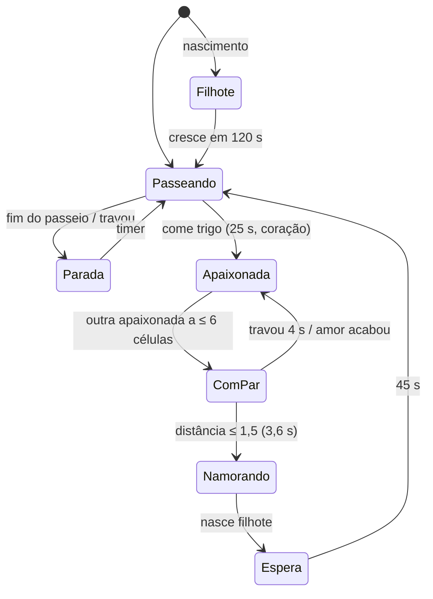
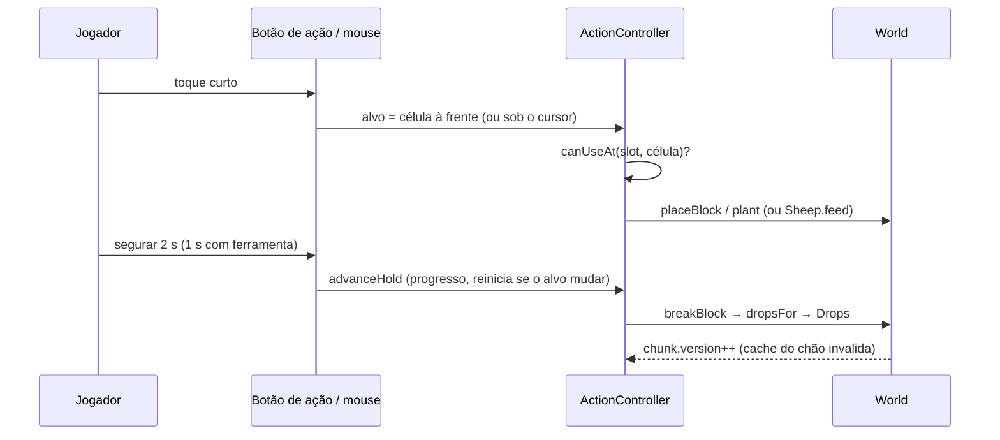
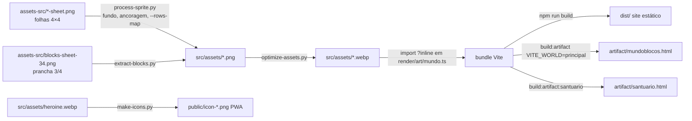

# Mapas do sistema

Diagramas em Mermaid (o GitHub renderiza). Mantenha-os em sincronia com `ARCHITECTURE.md` e os domínios.

## 1. Módulos e dependências
Setas = "importa/usa". `world/` é a base e não conhece ninguém acima dele.

## 2. Um quadro (frame)

```mermaid
flowchart LR
  A[Entrada<br/>teclado + joystick] --> B[Player.update<br/>Walker.move]
  B --> C[Entities.update<br/>ovelhas, pares, filhotes]
  C --> D[World.tick<br/>trigo cresce]
  D --> E[Drops.update<br/>coleta]
  E --> F[Camera.follow<br/>posição lógica]
  F --> G[updateBreaking<br/>segurar 2 s mão · 1 s ferramenta]
  G --> H[World.ensureChunks<br/>4 por frame · unloadFar 1/s]
  H --> I[Renderer.draw]
  I --> I1[chão: cache por chunk<br/>≤ 2 re-renders/frame]
  I1 --> I2[objetos + atores por linha]
  I2 --> I3[nuvens · dia/noite · partículas]
  I3 --> I4[foco · cursor · rachaduras]
  I4 --> J[Hud.update + botão de ação]
```

## 3. Célula do mundo e regras

## 4. Ciclo do trigo

## 5. Ciclo da ovelha

## 6. Ação do jogador

## 7. Pipeline de assets

## 8. Onde mexer para…
| Tarefa | Arquivos principais | Docs a atualizar |
|---|---|---|
| Novo bloco/material | `world/blocks.ts` (`MATERIALS`), prancha 3/4 + `scripts/extract-blocks.py`, `render/textures.ts` (contorno/barranca) | world, render, CHANGELOG |
| Regra de colocar/quebrar/pisar | `world/world.ts` (`placementLevel`, `breakTarget`, `standHeight`) + testes | world, MAPS §3 |
| Geração do mapa/biomas | `world/generator.ts` (`cellAt`), `world/biomes.ts` + `npm run bench` | world |
| Novo item ou ferramenta | `world/items.ts` (`StackId`, drops), `game/inventory.ts` (começo), `game/hotbar.ts`, `render/art/<mundo>.ts` (ícone) | farming |
| Água (substituir, encher buracos) | `world/world.ts` (`REPLACES_WATER`, `scheduleFlow/tickWater`), `render/renderer.ts` (`drawWaterFlows`) | world, render |
| Receita / profissão nova | `world/items.ts` (`RECIPES`, `PROFESSIONS`), ícone em `render/art/<mundo>.ts`; tela em `game/skills.ts` | farming |
| O que um bloco devolve ao quebrar | `world/items.ts` (`blockDrops/breakDrops`) | farming |
| Ação de ferramenta / toque / clique | `game/actionController.ts` (`canUseAt/applyUse/advanceHold`), `world/world.ts` | player, farming, MAPS §6 |
| Arte nova (qualquer) | gerar em `src/assets/`, importar no pacote do mundo `render/art/<mundo>.ts` (+ campo em `types.ts` se for tipo novo); se não for usada no começo, carregar em segundo plano | render, OPERATIONS, ADR 0010/0013 |
| Novo animal/NPC | `game/<animal>.ts` estendendo `Wanderer` (passeio) ou `Walker`, `game/entities.ts`, `render/character.ts` (`ActorKind`) | npc, MAPS §5 |
| Interior de construção | `assets-src/interiors/<id>.png`, `world/interiors.ts` (`InteriorDef`: mapa, construção, morador), `scripts/extract-interiors.py --grid`, `render/art/principal.ts` (`interiors`) | town, ADR 0014, OPERATIONS |
| Morador / roupa nova | `assets-src/villagers/`, `scripts/extract-villagers.py`, `game/villager.ts` (`VILLAGER_BASES`, `OUTFITS`), `render/art/principal.ts` | npc, OPERATIONS |
| Sprite da personagem | `assets-src/`, `process-sprite.py`, `optimize-assets.py`, `render/character.ts` | render, OPERATIONS |
| HUD / controles na tela | `game/hud.ts`, `game/actionButton.ts`, `game/joystick.ts`, `style.css` | player, README |
| Câmera / zoom | `game/camera.ts` | player |
| Visual do chão | `render/chunkRenderer.ts` (cache por chunk) | render |
| Novo mundo / mudar um mundo | `world/profiles.ts` (perfil), `world/flatGenerator.ts` ou gerador próprio, `render/character.ts` (personagem), script `build:artifact:<mundo>` | worlds, ADR 0008, OPERATIONS |
| Combate (vida, dano, espólios) | `world/progression.ts` (atributos, armas, `MONSTER_STATS`, `rollDamage`), `game/player.ts` (vida), `game/monster.ts` (`MONSTERS`: comportamento), `game/entities.ts` (mordida, mapa de distâncias, renascimento), `world/items.ts` (`monsterDrops`), `game/hud.ts` | dungeon, farming |
| Cidade (ruas, construções, regras) | `world/town.ts` (`buildTown`, `TOWN_SIZES`, `TownTerrain`), `world/blocks.ts` (ids 120–142), arte em `assets-src/town/` + `scripts/extract-town.py`, `World` (`isProtected`, `townBuildingAt`), `render/townArt.ts` + `town.test.ts` | town, ADR 0012 |
| Dungeon / monstro novo | `world/dungeon.ts` (área, spawns), `game/monster.ts` (`MONSTERS`), `game/entities.ts`, `render/character.ts` (`cycle`), `scripts/extract-dungeon.py` | dungeon, render, OPERATIONS, ADR 0009 |
| Estado novo que deve ser salvo / menu | `game/save.ts` (`SaveData`, `SAVE_VERSION`, captura/aplica), `game/menu.ts`, `main.ts` | save, ADR 0011 |
| Desempenho | `bench/perf.bench.ts`, `world/generator.ts`, `world/world.ts`, `render/renderer.ts` | ARCHITECTURE §Desempenho |
