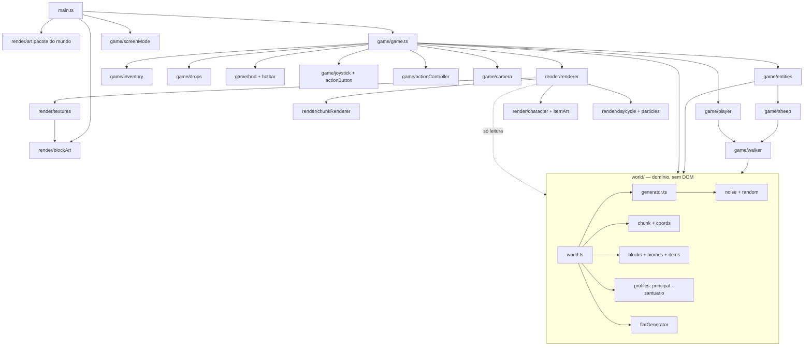
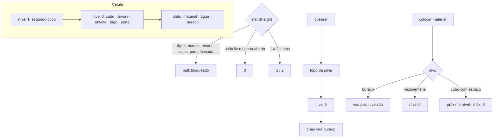
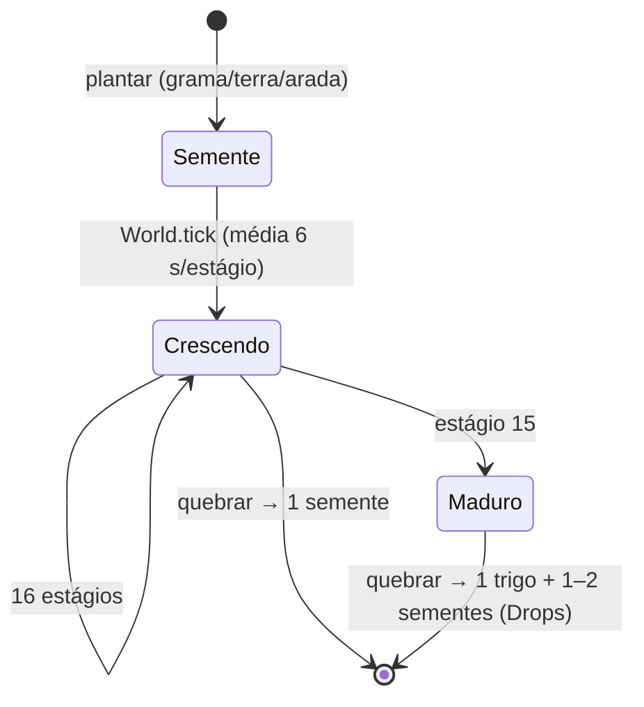
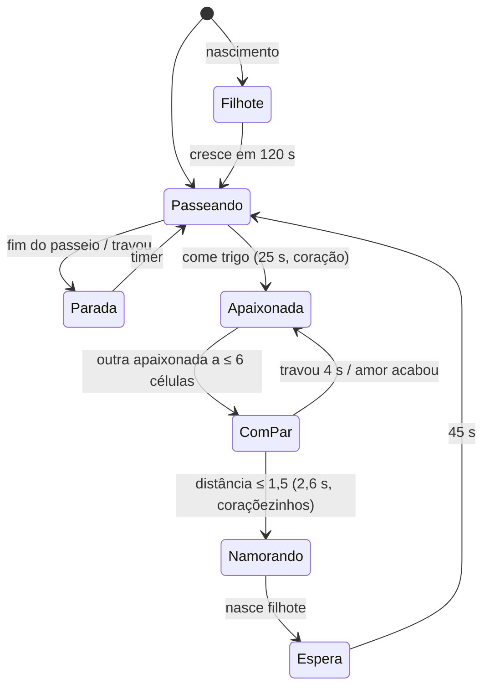
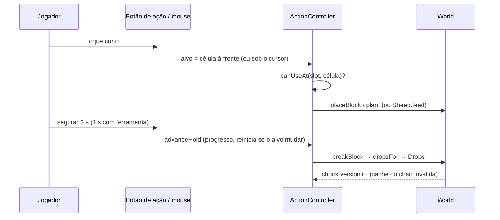
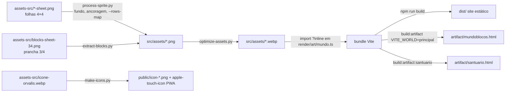

# Mapas do sistema

Diagramas em Mermaid (o GitHub renderiza). Mantenha-os em sincronia com `ARCHITECTURE.md` e os domínios.

> **PR #87 — mudança dirigida:** `config.ts` limita `MAX_STACK=2`; `render/renderer.ts` → `render/adaptiveWalls.ts` seleciona e desenha paredes horizontais de construção no renderizador top-down oficial, preservando a face frontal. Não altera `World` além da validação de nível obsoleto nem a renderização de terreno natural.

> **Mundo em 2.5D (M2.1, v0.93.30; só dev `?render=3d`):** `render/worldThreeRenderer.ts` · `render/three/chunkFloor.ts` · `WORLD_THREE_OPTIONS` em `rendererContract.ts` · `main.ts` (flag sob `import.meta.env.DEV`).
> **Núcleo 2.5D genérico (M1, v0.93.29):** `render/three/{stage,selection,blockMaterials}.ts` · usado por `sanctuaryThreeRenderer.ts`; o Mundo (M2) reaproveita.
> **Porta de parede (v0.93.25):** `Block.WALL_DOOR_*`, `World.canPlaceWallDoor` · `wallAtlas.ts` (`doorPieceFor`, `wallArtBase`) · `sanctuaryWallArt.ts` · contrato 3b + `gabarito-porta.png`.
> **Paredes com arte (W3, v0.93.22):** `scripts/build-wall-atlas.py` → `src/assets/walls-<material>.webp` · `render/wallAtlas.ts` (layout + `wallArtPiece`) · `render/sanctuaryWallArt.ts` (planos instanciados) · `ArtPack.wallAtlases` em `render/art/santuario.ts`.

> **Iluminação (ADR 0029, v0.93.19):** `render/lighting.ts` (regras puras, `?luz=`) · `render/sanctuaryLighting.ts` (shader de escuridão com poças de luz).

> **Paredes (ADR 0027, v0.93.15):** `world/walls.ts` (autotile puro: frente, tampa de 16 peças, cantos internos) · `Block.WALL_PLANKS`/`WALL_STONE` em `world/blocks.ts` (`isWall`, `WALL_BLOCKS`) · `World.isWallAt`/`wallPieceAt` · `render/sanctuaryWallPrototype.ts` (protótipo de cores lisas, `?paredes=autotile`). Arte e render final: W1/W3.

> **v0.93.x — vista e escala do Santuário:** `render/sanctuaryObliqueView.ts` (projeção oblíqua, K = 1) · `render/worldScale.ts` (relações do Core Keeper: cubo 1,0, parede ≈ 1,2, personagem ≈ 1,2) · `render/sanctuaryWallProportionTest.ts` (teste `?paredes=teste`, descartável) · `Camera.setCellsTall` + `GameRenderer.preferredCellsTall` (células visíveis). ADRs 0026–0028.

> **PR #89 — Santuário oficial Three.js:** `main.ts` importa dinamicamente `render/sanctuaryThreeRenderer.ts` somente no perfil Santuário → usa `render/sanctuaryThreeLayout.ts` e as faces de `celestialArt.ts`, lê `World` e implementa o contrato `render/rendererContract.ts`. O `Game` continua compartilhado. O perfil principal segue `render/renderer.ts` Canvas 2D; `?render=2d` permite fallback.

## 1. Módulos e dependências
Setas = "importa/usa". `world/` é a base e não conhece ninguém acima dele.

## 2. Um quadro (frame)

```mermaid
flowchart LR
  A[Entrada<br/>teclado + joystick] --> B[Player.update<br/>Walker.move]
  B --> C[Entities.update<br/>ovelhas, pares, filhotes]
  C --> D[World.tick<br/>trigo cresce]
  D --> E[Drops.update<br/>coleta]
  E --> F[Camera.follow<br/>posição lógica]
  F --> G[updateBreaking<br/>segurar 2 s mão · 1 s ferramenta]
  G --> H[World.ensureChunks<br/>4 por frame · unloadFar 1/s]
  H --> I[Renderer.draw]
  I --> I1[chão: cache por chunk<br/>≤ 2 re-renders/frame]
  I1 --> I2[objetos + atores por linha]
  I2 --> I3[nuvens · dia/noite · partículas]
  I3 --> I4[foco · cursor · rachaduras]
  I4 --> J[Hud.update + botão de ação]
```

## 3. Célula do mundo e regras

## 4. Ciclo do trigo

## 5. Ciclo da ovelha

## 6. Ação do jogador

## 7. Pipeline de assets

## 8. Onde mexer para…
| Tarefa | Arquivos principais | Docs a atualizar |
|---|---|---|
| Novo bloco/material | `world/blocks.ts` (`MATERIALS`), prancha 3/4 + `scripts/extract-blocks.py`, `render/textures.ts` (contorno/barranca) | world, render, CHANGELOG |
| Transição entre chãos (forma por par, água, grama) | `assets-src/materiais/_mascaras/`, `scripts/import-transition.py` (da pintura do par) ou `import-mask.py` + `build-materials.py` (`transitions-v2.webp`), `render/transitions.ts` (`TRANSITION_RULES`, `transitionPieces`), `render/textures.ts` (`buildTransitions`), `render/chunkRenderer.ts`, `world/world.ts` (`touch` diagonal) | render, ADR 0023 |
| Material no Padrão V2 (ADR 0023) | `assets-src/materiais/<material>/` + `CONTRATO.md`, `scripts/import-material.py`, `scripts/build-materials.py`, `render/materialsV2.ts` (`V2_BLOCKS`), `render/textures.ts` (`composeCube`, `applyMaterialsV2`, `qaMaterial`, `cubeSpriteV2`, `drawCubeParts`), `render/renderer.ts` (`drawCubeV2`, `cubeView`), `render/chunkRenderer.ts` (grade sutil; `continuousGround`), `render/blockArt.ts` (`loadMaterialsV2`), `dev/materialsScene.ts` (`?materiais=1`), `main.ts` (chaves) | render, ADR 0022, CONVENTIONS |
| Regra de colocar/quebrar/pisar | `world/world.ts` (`placementLevel`, `breakTarget`, `standHeight`) + testes | world, MAPS §3 |
| Geração do mapa/biomas | `world/generator.ts` (`cellAt`), `world/biomes.ts` + `npm run bench` | world |
| Novo item ou ferramenta | `world/items.ts` (`StackId`, drops), `game/inventory.ts` (começo), `game/hotbar.ts`, `render/art/<mundo>.ts` (ícone) | farming |
| Água (substituir, encher buracos) | `world/world.ts` (`REPLACES_WATER`, `scheduleFlow/tickWater`), `render/renderer.ts` (`drawWaterFlows`) | world, render |
| Receita / profissão nova | `world/items.ts` (`RECIPES`, `PROFESSIONS`), ícone em `render/art/<mundo>.ts`; tela em `game/skills.ts` | farming |
| O que um bloco devolve ao quebrar | `world/items.ts` (`blockDrops/breakDrops`) | farming |
| Ação de ferramenta / toque / clique | `game/actionController.ts` (`canUseAt/applyUse/advanceHold`), `world/world.ts` | player, farming, MAPS §6 |
| Arte nova (qualquer) | gerar em `src/assets/`, importar no pacote do mundo `render/art/<mundo>.ts` (+ campo em `types.ts` se for tipo novo); se não for usada no começo, carregar em segundo plano | render, OPERATIONS, ADR 0010/0013 |
| Novo animal/NPC | `game/<animal>.ts` estendendo `Wanderer` (passeio) ou `Walker`, `game/entities.ts`, `render/character.ts` (`ActorKind`) | npc, MAPS §5 |
| Interior da tenda (entrar/sair, mapa) | `world/interiors.ts` (`TENT_INTERIOR`, `tentLayout`), `world/world.ts` (`tentRoom`, `tentDoorAt`), `game/game.ts` (`updateInteriors`, `roomExit`, `tentReturn`), `render/art/principal.ts` (`interiors.tent`) | town, ADR 0014 |
| Interior de construção | `assets-src/interiors/<id>.png`, `world/interiors.ts` (`InteriorDef`: mapa, construção, morador), `scripts/extract-interiors.py --grid`, `render/art/principal.ts` (`interiors`) | town, ADR 0014, OPERATIONS |
| Personagem pronto (Heroína/Herói) e escolha no Novo mundo | `game/entities.ts` (`HeroBody`, `body`), `render/character.ts` (`SPECS` hero*), `render/art/principal.ts`, `game/title.ts` (`creatorOnly`), `render/characterPreview.ts`, `main.ts` (`chooseCharacterForNewWorld`), `game/save.ts` (`body`) | player, save |
| Multiplayer — itens no chão e baús da sala | `net/room.ts` (`spawnDrops`, `take`, `chest`), `net/protocol.ts` (`RoomDrop`, `parseChestSlots`), `net/session.ts` (`onDrops`, `onTaken`, `onChest`, `take`, `sendChest`), `game/drops.ts` (`addShared`, `claim`, `resolveClaim`), `game/actionController.ts` (`sharedLoot`), `game/game.ts` (`refreshChestUi`) | ADR 0020 |
| Multiplayer — bichos da sala (aranhas e animais) | `game/entities.ts` (`avatars`, `onBite`, `strikeFrom`, `biteFrom`, `remote`, `extra`, `spawnWildlife`), `net/room.ts` (`entities`, `mobsNear`, `strike`/`feed`, `MOBS_EVERY`), `net/protocol.ts` (`MobState`, `FACING_ORDER`), `net/session.ts` (`onMobs`, `onBite`, `onHits`, `onFed`, `strike`, `feed`), `game/creatureMirror.ts`, `game/actionController.ts` (`onFeed`), `game/game.ts`; servidor `src/app.js` (`TICK_MS`) | npc, dungeon, ADR 0021 |
| Multiplayer — aparência de cada jogador (e ferramenta/golpe: `PlayerState.tool`/`swing`, `heroActorKind`, `Player.swings`) | `net/protocol.ts` (`Appearance`, `parseAppearance`, `parseState`), `net/room.ts` (`PlayerInfo.appearance`), `game/remotePlayers.ts`, `main.ts` (`goOnline`) | player, ADR 0016 |
| Multiplayer — salas fixas, mundo e bolsa salvos | `net/protocol.ts` (`ROOMS`, `RoomBag`, `parseBag`), `net/room.ts` (`snapshot`, `restore`), `net/session.ts` (`bag`, `sendBag`), `net/socket.ts` (`fetchRoomCounts`), `game/menu.ts`, `game/game.ts` (`sendBag`), `main.ts`; servidor `src/app.js`, `src/store.js` | ADR 0020 |
| Multiplayer — hora e crescimento da sala | `net/room.ts` (`time`, `tick`, `grown`), `net/session.ts` (`time`, `onTime`, `grow`), `world/world.ts` (`tick` com `grow`/`onGrow`, `applyGrowth`), `game/game.ts`; servidor `src/app.js` (relógio 10×/s; plantas de segundo em segundo) | ADR 0016 |
| Multiplayer (mensagem nova, regra de sala, ação nova) | `src/net/protocol.ts` (+ `PROTOCOL_VERSION` se incompatível), `src/net/room.ts`, `src/world/actions.ts`, `src/net/net.test.ts`; o servidor (`maiam/orvalis-servidor`) atualiza o pacote | ADR 0016, NEXT_STEPS Fase M |
| NPC novo / nome / fala / retrato | `assets-src/npcs/`, `game/npcs.ts` (`NPCS`), `game/villager.ts`, `scripts/make-portraits.py`, `render/art/principal.ts`, `render/character.ts` (`SPECS`) | npc |
| Caixa de conversa (moldura, páginas, setinha) | `game/dialogue.ts` (`DialogueBox`, `paginate`), `style.css` (`.dlg-*`), `game/game.ts` (`talkTo`, `updateDialogue`), `assets-src/dialogo-moldura.png` | npc |
| Sprite da personagem | `assets-src/`, `process-sprite.py`, `optimize-assets.py`, `render/character.ts` | render, OPERATIONS |
| Ferramentas novas (níveis/materiais) — contrato de arte | `assets-src/ferramentas/CONTRATO.md`, `catalogo.json`, `world/items.ts` (`TOOLS`), `world/progression.ts` (`WEAPON_POWER`) | ADR 0018, farming |
| Pedregulhos (arte, gerador, drops) | `world/blocks.ts` (`ROCK_BOULDER`), `world/generator.ts`, `world/items.ts` (`blockDrops`), `render/textures.ts`, `scripts/extract-rocks.py` | world |
| Bloco que saiu do jogo (antigas paredes 210–225): dados antigos viram vazio | `world/blocks.ts` (`isRemovedBlock`, `isRemovedStack`), `world/world.ts` (`restoreChunk`, `setLevel`), `game/save.ts` (`withoutRemovedBlocks`), `net/protocol.ts` (`parseBag`, `parseChestSlots`) | world, save, ADR 0016 |
| Cerca e portão (emenda por vizinhos, abrir/fechar, receitas) | `world/blocks.ts` (`FENCE*`, `joinsFence`, `toggled`), `world/world.ts` (`toggleDoor`), `world/items.ts` (receitas, `blockDrops`), `render/fence.ts` (`fenceParts`), `render/renderer.ts` (`drawFence`), `render/textures.ts` (`fenceTextures`), `scripts/extract-fence.py` | world, render |
| Bolsa (12, à direita) e ficha de receita | `game/hotbar.ts` (`BAG_SLOTS`), `game/bag.ts` (`peek`), `game/skills.ts` (`openDetail`, `renderDetail`), `game/hud.ts` (`.hotbar-side`), `game/game.ts` (`craftDestination`, `spillBagOverflow`), `style.css` (`.recipe-*`) | farming |
| Fome, comida, Cozinheiro (pesos, comer, receitas no caldeirão) | `world/progression.ts` (`HUNGER`, `FOOD`), `game/player.ts` (`hunger`, `eat`), `game/actionController.ts` (`eatInstead`), `world/items.ts` (`Recipe.station`, `cook`), `game/skills.ts`, `game/hud.ts` (`setHunger`), `game/game.ts` (`nearStation`) | player, farming |
| Covil isolado e entrada de caverna (posição, entrar/sair, escuridão) | `world/dungeon.ts` (`isolatedDungeon`, `planCave`, `DungeonTerrain`), `world/world.ts` (`cave`, `isCaveDoor`, `isDungeonExit`), `game/game.ts` (`updateInteriors`), `render/renderer.ts` (`darkenOutside`), `render/textures.ts` (caverna) | dungeon, ADR 0019 |
| Biomas do mundo da Cidade 1 | `world/biomes.ts` (`pickBiome`) | world, ADR 0019 |
| Culturas da horta (trigo, batata, tomate, cenoura) | `world/blocks.ts` (`CROPS`), `world/items.ts` (`ITEMS`, `dropsFor`), `world/world.ts` (`CROP_STAGE_SECONDS`), `render/itemArt.ts` (`loadCropSprites`), `scripts/extract-crops.py` | farming |
| Lobos (bandos, regra das 3 células, ficha) | `world/wolves.ts` (`wolfPacks`), `game/monster.ts` (`MONSTERS`, `WOLF_SIGHT`), `world/progression.ts` (`MONSTER_STATS`), `game/entities.ts` (`spawnWolves`, `ACTIVE_RADIUS`), `render/character.ts` (`SPECS`), `assets-src/lobos/` | dungeon, render |
| Árvores adultas (variantes) / maçãs / madeira de cerejeira | `world/blocks.ts` (`TREE_NEXT`, `GROWTH_STAGE_ADULT`, `CHERRY_*`, `BIRCH_*`), `world/biomes.ts` (`altTrees`), `world/world.ts` (`pick`, `tick`, `inWallChunk`), `world/items.ts` (`treeDrops`, `blockDrops`, `pickDrops`), `render/textures.ts` (`growthTreeSprites`, `TREE_FRAMES`), `scripts/process-trees.py` (carvalho, macieira, cerejeira, bétula), `scripts/extract-trees.py` (cacto), `scripts/make-material-icons.py` | farming, render |
| Animais do campo (cavalo, vaca, galinha), filhotes e reprodução | `game/breeder.ts` (`Breeder`), `world/items.ts` (`feeds`), `game/actionController.ts` (`feedInstead`), `game/horse.ts` (`FarmAnimal`, `FARM`, `BABY_KIND`), `game/entities.ts` (`spawnAnimals`), `render/character.ts` (`SPECS`) | npc |
| Minimapa e névoa (cores, marcadores, raio, salvamento) | `src/render/minimap.ts`, `render/mapColors.ts`, `game/exploration.ts`, `game/game.ts` (`updateMinimap`, `REVEAL_RADIUS`), `world/profiles.ts` (`minimap`) | render, save |
| Tela de entrada / montar o personagem (escolher entre os 5 prontos, nome, Continuar) | `src/game/title.ts`, `render/characterPreview.ts`, `render/modular.ts` (`lookOptions`, `randomLook`, `cleanLook`), `game/game.ts` (`showcase`, `look`), `main.ts` (`showTitle`) | player, save |
| HUD / controles na tela | `game/hud.ts`, `game/actionButton.ts`, `game/joystick.ts`, `style.css` | player, README |
| Câmera / zoom | `game/camera.ts` | player |
| Visual do chão | `render/chunkRenderer.ts` (cache por chunk) | render |
| Novo mundo / mudar um mundo | `world/profiles.ts` (perfil), `world/flatGenerator.ts` ou gerador próprio, `render/character.ts` (personagem), script `build:artifact:<mundo>` | worlds, ADR 0008, OPERATIONS |
| Combate (vida, dano, espólios) | `world/progression.ts` (atributos, armas, `MONSTER_STATS`, `rollDamage`), `game/player.ts` (vida), `game/monster.ts` (`MONSTERS`: comportamento), `game/entities.ts` (mordida, mapa de distâncias, renascimento), `world/items.ts` (`monsterDrops`), `game/hud.ts` | dungeon, farming |
| Cidade (ruas, construções, regras) | `world/town.ts` (`buildTown`, `TOWN_SIZES`, `TownTerrain`), `world/blocks.ts` (ids 120–142), arte em `assets-src/town/` + `scripts/extract-town.py`, `World` (`isProtected`, `townBuildingAt`), `render/townArt.ts` + `town.test.ts` | town, ADR 0012 |
| Dungeon / monstro novo | `world/dungeon.ts` (área, spawns), `game/monster.ts` (`MONSTERS`), `game/entities.ts`, `render/character.ts` (`cycle`), `scripts/extract-dungeon.py` | dungeon, render, OPERATIONS, ADR 0009 |
| Estado novo que deve ser salvo / menu | `game/save.ts` (`SaveData`, `SAVE_VERSION`, captura/aplica), `game/menu.ts`, `main.ts` | save, ADR 0011 |
| Desempenho | `bench/perf.bench.ts`, `world/generator.ts`, `world/world.ts`, `render/renderer.ts` | ARCHITECTURE §Desempenho |
